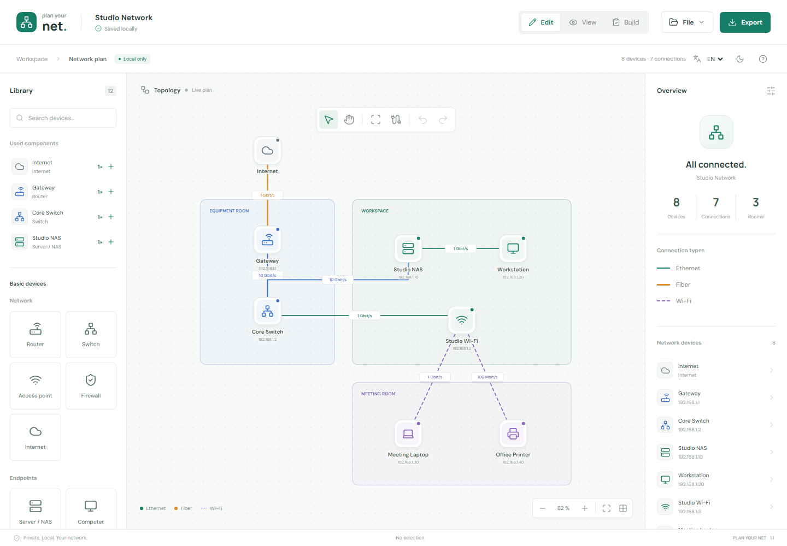
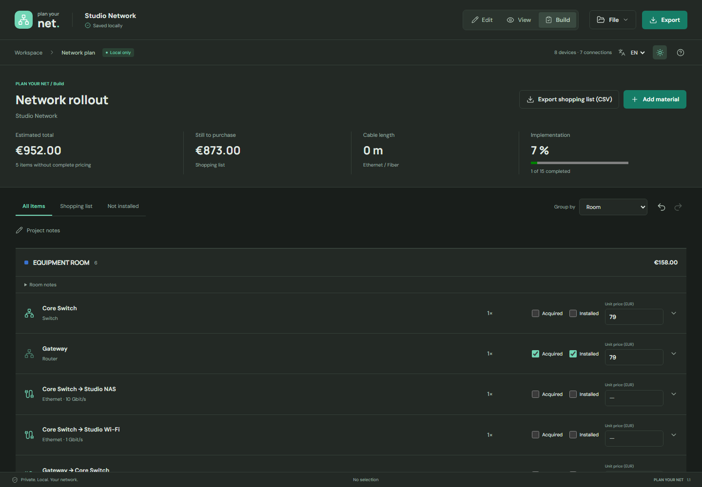

# Plan Your Net

**Draw your network. Plan the equipment. Work through the rollout.**

A local network planner built with native Web Components, strict TypeScript, and esbuild. The web build is a static frontend with no backend or runtime dependency on Node.js. An optional Electron build packages the same frontend as a desktop app with its own bundled runtime. Fonts, icons, and language packs are bundled locally; neither version needs an application server or third-party network requests.

MIT licensed · German / English · Light / dark · Static web + Windows x64 desktop



<details>
<summary>Rollout and purchasing view</summary>



</details>

Formerly developed as Netmap. Existing plans remain compatible; the previous storage/profile identifiers are deliberately retained. The project is hosted at [github.com/freequenzart/plan-your-net](https://github.com/freequenzart/plan-your-net); this is not a trademark or name-availability assessment.

For prebuilt downloads, planned release assets are `Plan-Your-Net-<version>-web.zip`, `Plan-Your-Net-<version>-x64.exe`, and `SHA256SUMS.txt`. No release has been published yet; see [the repository Releases page](https://github.com/freequenzart/plan-your-net/releases) and [the release checklist](docs/RELEASING.md).

## Getting started

Install Node.js 22 or newer and npm, then run:

```sh
npm ci
npm run dev
```

The development server prints its local URL. It binds to `127.0.0.1` and chooses an available port starting at 8000. Set `PORT` to request a specific port; in PowerShell, for example, use `$env:PORT=5173` before running the command. TypeScript and CSS changes trigger rebuilds and browser reloads.

To create a production build:

```sh
npm run build
```

Open the root `index.html` after building, or open `dist/index.html`. Both work directly from the filesystem because the build emits a classic IIFE bundle rather than browser modules. The root entry retains the previous file path for existing browser data. To publish, upload the complete **contents of `dist/`** to any static web server. The output contains all icons, fonts, and styles and needs neither npm nor a running Node.js process.

`npm run preview` serves the already built `dist/` without rebuilding it. Development and preview servers are local tooling, not application backends.

### Commands

| Command                   | Purpose                                                                               |
| ------------------------- | ------------------------------------------------------------------------------------- |
| `npm run dev`             | Development server, watch compilation, source maps, and live reload                   |
| `npm run build`           | Strict type check, optimized bundle, and complete static output in `dist/`            |
| `npm run build:watch`     | Initial build and ongoing TypeScript/CSS/HTML/public-asset rebuilds, without a server |
| `npm run preview`         | Serve the existing production output locally                                          |
| `npm run typecheck`       | Strict TypeScript check without emitting files                                        |
| `npm run typecheck:watch` | Continuous strict type checking                                                       |
| `npm test`                | TypeScript regression tests with Node's test runner and tsx                           |
| `npm run test:watch`      | Rerun tests when their dependencies change                                            |
| `npm run format`          | Format application, tests, build scripts, HTML, and documentation                     |
| `npm run format:check`    | Check formatting without modifying files                                              |

Development and watch compilation use esbuild for fast transpilation; they do not replace TypeScript checking. Run `npm run typecheck:watch` in another terminal for continuous diagnostics. Production `build` always runs the type checker first. Stop long-running commands with Ctrl+C. Build and watch commands write the same output directory, so run only one writer at a time.

The first launch opens an editable example. **File → New plan** creates an empty document. Replacing a plan requires confirmation and can be undone.

## Electron desktop application

### Release checks and archives

| Command                     | Purpose                                                                                                                     |
| --------------------------- | --------------------------------------------------------------------------------------------------------------------------- |
| `npm run release:check`     | Check package/license identity, lockfile, required documents, pinned workflow structure, and limited source secret patterns |
| `npm run test:e2e`          | Build and test desktop/mobile Chromium workflows; install Chromium first with `npx playwright install chromium`             |
| `npm run test:e2e:ui`       | Open the interactive browser-test runner                                                                                    |
| `npm run screenshots`       | Generate documentation images from fresh synthetic demo data                                                                |
| `npm run release:web`       | Build the web ZIP and SHA-256 checksum in `artifacts/`                                                                      |
| `npm run release:artifacts` | Assemble an already built website and Windows EXE into `artifacts/` with checksums                                          |

Artifact generation replaces the generated `artifacts/` directory; do not store personal files there. Production builds omit source maps; development/watch builds retain them. See [CONTRIBUTING.md](CONTRIBUTING.md), [SECURITY.md](SECURITY.md), and [docs/RELEASING.md](docs/RELEASING.md).

The web commands above are unchanged. Electron uses the same TypeScript components, styles, language packs, storage schema, and JSON/SVG implementation, plus a small desktop main process in `electron/main.ts`.

```sh
npm run dev:electron
```

This builds the renderer and main process into `dist-electron-dev/`, watches their dependencies, and restarts the Electron window after successful changes. HTML and public-asset changes are also watched. Restarts clear temporary selection and undo history but keep completed edits in the separate development profile. Closing the window does not stop the watcher; use Ctrl+C in the terminal. Type checking remains available through `npm run typecheck:watch`.

To build and run the desktop release locally:

```sh
npm run build:electron
npm run start:electron
```

### Desktop commands

| Command                        | Purpose                                                                                   |
| ------------------------------ | ----------------------------------------------------------------------------------------- |
| `npm run dev:electron`         | Watch renderer/main process and restart the desktop window on changes                     |
| `npm run build:electron`       | Strict type check, desktop renderer, and bundled Electron main process                    |
| `npm run start:electron`       | Run an existing desktop build without rebuilding                                          |
| `npm run package:electron`     | Build and package a portable Windows x64 executable in `release/`                         |
| `npm run package:electron:dir` | Build an unpacked Windows x64 app in `release/win-unpacked/`                              |
| `npm run test:electron`        | Build, launch with an isolated test profile, verify renderer/SVG/Node isolation, and exit |

The portable artifact is named `Plan-Your-Net-<version>-x64.exe`. It does not need a separate Electron or Node.js installation on the target machine. The unpacked app requires the complete `win-unpacked/` folder, not only its executable. The supplied package targets are Windows x64; macOS/Linux distribution and signing are not configured. Initial installs and packaging may download Electron and packaging binaries.

Artifacts are **unsigned**. Windows SmartScreen or organizational policies may display a warning or block an unknown application. No automatic publishing, updates, or elevated installation are configured. Code signing requires a separately configured certificate. The icon is generated automatically from `public/favicon.svg` as a multi-resolution ICO (16–256 px) and a window PNG. It is embedded in both the application executable and the portable executable. Changing the SVG and rebuilding updates all desktop icons. Resource editing is enabled while code signing remains disabled.

Build outputs are independent: web uses `dist/`, desktop release uses `dist-electron/`, desktop development uses `dist-electron-dev/`, and packaged artifacts use `release/`. Web development and Electron development can run together. Do not run multiple writers for the same output directory, or package while the desktop release is running from the build directory.

### Desktop storage and security

Release data is stored in Electron's `Netmap` user-data profile, normally `%APPDATA%/Netmap` on Windows. Development uses `%APPDATA%/Netmap Development`; smoke tests use a separate temporary profile. Portable refers to the executable: user data is still stored in the user's profile, not next to the executable.

Desktop and browser storage are separate. Export JSON or a Plan Your Net SVG from the web app, then import it in the desktop app to transfer a plan. The document and preference keys remain unchanged. Production and development builds do not modify each other's stored plans.

The desktop renderer has Node integration disabled, context isolation and Chromium sandboxing enabled, a restrictive content-security policy, and no preload bridge. Unexpected navigation, popups, webviews, and permission requests are blocked. Only exports generated as blob URLs by the main application window can open a download/save dialog. Only one instance per profile is allowed. No remote URL is used for desktop development.

## Editing

### Guided introduction

On the first launch, an eight-step introduction highlights the actual mode switch, room tool, device library, essential properties, reused components, cable tool, rollout prices, and file menu. It explains the intended workflow without changing the document. Use Next/Back or the arrow keys, Skip, or Escape. Completion/skipping is remembered under `netmap.onboarding.v1`; the question-mark button starts the introduction again. The tour supports both languages and opens the relevant panels on small screens.

- Click a device in the library or drag it onto the canvas. Select and move devices; edit their names, IP addresses/hostnames, types, and colors in the properties panel.
- Add custom endpoint types in the device library, choose an icon, and place them like built-in devices. Their definitions are stored in the plan JSON and can also be imported or exported individually.
- Duplicate and delete are directly below the selected item's heading. Technical details, article/planning information, and coordinates are collapsed by default; their open state is retained while editing the same item. The essential name/type/IP/color controls remain visible.
- Draw an area with the room tool. Resize selected rooms using their corner handle. Moving a room also moves the devices inside it; deleting a room keeps its devices.
- Select two devices with the connection tool. Select a line to change its name, medium, speed, and color.
- Property fields commit on blur, Tab, Enter, and before canvas selection changes. Unchanged values do not create undo entries.
- Ethernet, fiber, and Wi-Fi are available, with speeds from 10 Mbit/s to 1000 Gbit/s. These are planning labels, not measured speeds.
- Use the hand tool or middle mouse button to pan; use the wheel or zoom buttons to zoom. Fit displays the entire document, including custom bend points.
- **Status** is read-only and shows the complete plan. Devices and connections are tinted green when acquired and installed, and orange when either step remains. On smaller screens, **Library** and **Details** open the side panels. Mouse, pen, and single touch pointers are supported; zoom buttons are available for touch input.

### Reusable components and references

Duplicating a device or placing it again from **Used components** creates another physical instance of the same component, not an unrelated product. The library lists component groups and their current instance counts, and supports click placement or drag-and-drop. A new basic device from the catalog is independent even if it has the same type.

References share technical specifications, custom attributes, manufacturer, model/article number, and unit price. IP address, display name, color, position, notes, and acquired/installed state remain per instance. Changing an individual device's technical data, article fields, or price automatically makes that instance independent (copy-on-write); **Make independent** does so explicitly. Moving or renaming an instance does not split its component. Removing the original device leaves its other references usable. All these operations support undo/redo and are preserved in JSON and Plan Your Net SVG metadata.

Device quantities always come from placed instances. There is no editable device quantity field. Legacy `planning.quantity` values on devices remain importable but no longer multiply device costs; quantities for cables and additional materials still work as before.

### Build / rollout mode

**Build** is a third mode alongside **Edit** and **Status**. It lists the devices, connections, and additional materials by room, with separate **Acquired** and **Installed** checkboxes. Completion, prices, properties, and notes are stored in the same document, automatically saved locally, included in JSON/Plan Your Net SVG exports, and support undo/redo.

In **Status**, the full topology stays visible: green indicates acquired and installed; orange indicates that purchase or installation is still outstanding. This is derived directly from the existing checkboxes, with no separate status field. In **Build**, **Planned state** and **Current state** remain available as list filters alongside the shopping-list and not-installed filters. In **Edit**, **Mark as current state** marks all devices and connections complete in one undoable change; wireless links are marked installed without purchase.

- Devices are assigned geometrically to the smallest containing room; overlapping rooms use a deterministic tie-breaker. Devices outside rooms appear under **Unassigned**. Moving a device or a room updates this grouping.
- Connections appear once under their source device's room, or the target's room if the source is unassigned. Their endpoint names identify room-to-room connections. They are never double-counted in totals.
- Matching device references are combined into one row per room, with the automatically counted quantity. Enter the unit price directly in the collapsed row; this component-level price applies to every reference, including other rooms. Purchase/install checkboxes on a grouped row affect the displayed instances in that room, not all rooms. Partly completed groups show a mixed state. Expanded rows list the individual devices with their own status and a shortcut back to editing.
- Other properties stay collapsed. Expand to edit manufacturer, model/article number, notes, or cable/material quantities. Technical fields are in a second collapsed section. Editing these individual-device details separates the named instance from its references, while the inline component price remains shared. Switches have port counts, uplink ports, management type (managed/unmanaged/smart), and PoE; other device types expose appropriate fields such as Wi-Fi standard/SSID, CPU, RAM, storage, OS, power, and interfaces. Add arbitrary name/value properties where needed.
- Wired connections have a cable/connector type, an explicitly entered length in meters, and a choice of price **per piece** or **per meter**. Length is not inferred from canvas coordinates. Per-meter costs are quantity × length × unit price; fixed-price cables use quantity × unit price. Wi-Fi connections are implementation tasks, not physical cable purchases, and do not contribute cable costs or lengths.
- **Add material** creates additional purchasing positions, for example patch panels, connectors, or cable ducts, without adding topology devices. Choose a room and either pieces or meters as the unit. Meter materials accept fractional quantities. Deleting a room leaves its materials under **Unassigned**.
- Project notes, room notes, and individual item notes capture installation requirements. They are separate from device names and existing topology labels.
- Costs are estimated in EUR. The overview shows the known total, the known amount still to purchase, physical cable meters, and installed physical devices/positions. Acquired items remain in the total but leave the shopping list. Missing prices remain blank and are not treated as confirmed free items. Device costs use actual placed instances; grouped quantities are informational and cannot be edited. Cable/material status applies to their whole position.
- Filters follow the rollout workflow: **Planned state**, **Current state**, **Shopping list**, and **Not installed**. When an acquired or installed item leaves the corresponding filtered list, it briefly fades out while the remaining positions move into place. Status changes are saved immediately; the animation does not add undo steps or delay persistence. It also handles individual instances in reference groups and respects reduced-motion preferences. **Export shopping list (CSV)** downloads outstanding physical purchases with room, quantities, prices, cable lengths, totals, and notes. Checkboxes and procurement metadata do not change the visual network topology.
- **Group by** switches independently between **Room** and **Device type**. Changing the grouping keeps the active status/shopping filter, and changing a filter keeps the grouping. Device-type groups collect switches, routers, endpoints, and other types across rooms; references to the same component are combined across rooms as well. Connections are grouped by medium and additional materials have their own group. The contained rooms remain visible in device rows. Grouping changes neither the plan nor the cost/progress overview; grouped status checkboxes affect only the currently listed instances. Grouping is retained while switching modes or languages, and defaults to Room after reloading.

Prices, cable lengths, quantities, and device specifications are planning values entered by the user, not discovered hardware data or supplier quotes. The document format remains version 1 with optional metadata, so old files remain valid. Earlier Netmap/Plan Your Net versions do not know these optional fields and may discard them when saving; use the current version for planning documents.

### Orthogonal routing

- Select a line, then click it again where you want to insert a bend point. Alternatively, use **Add bend point** in its properties.
- Drag the circular point to adjust the route. Custom routes use horizontal and vertical segments with 90-degree corners; additional elbows are generated automatically between the control points.
- Each control point is listed in the properties panel and can be removed there. **Reset route** returns to automatic routing. Wireless connections are straight by default and become orthogonal when bend points are added.
- Adding, moving, removing, and resetting points support undo/redo and automatic saving. Points are retained in both JSON and Plan Your Net SVG files. Up to 100 control points are supported per connection.
- Control points use absolute canvas coordinates. Moving an endpoint recomputes its connecting segments while keeping the control points fixed.
- Connection labels start at the route midpoint. In **Edit**, drag a label to move it independently; labels remain above all connection lines. Their positions are saved in JSON/SVG, included in **Fit**, and support undo/redo.

### Appearance and language

Use the language selector to switch between German and English, and the sun/moon button to switch between light and dark themes. Initial defaults follow the browser language and system color scheme. Explicit choices are saved separately under `netmap.preferences.v1` and survive reloading.

Switching language updates the interface without renaming user-authored document, room, device, or connection names. Dark mode lightens diagram colors for readability without changing their saved values.

### Keyboard

| Key                                  | Action                                         |
| ------------------------------------ | ---------------------------------------------- |
| V / H / R / C                        | Select / pan / room / connection               |
| Delete or Backspace                  | Delete selection                               |
| Esc                                  | Cancel the current gesture and clear selection |
| Ctrl/Cmd + Z                         | Undo                                           |
| Ctrl/Cmd + Shift + Z or Ctrl/Cmd + Y | Redo                                           |
| Ctrl/Cmd + S                         | Save the current JSON file                     |
| + / - / F                            | Zoom / fit entire plan                         |

## JSON and SVG files

**Save** writes to the JSON file opened through the app's file picker. After a file is selected, subsequent saves and Ctrl/Cmd+S overwrite it directly. The first save without an open file asks where to save. Browsers without the File System Access API fall back to a JSON download; file handles are kept for the current app session. The **File** menu also offers **Export SVG**, **Export JSON**, and **Import JSON / SVG**. Imports require confirmation before replacing the current plan.

SVG export includes the entire plan, independent of pan and zoom, in the current light/dark theme. It omits selection markers, the grid, and editing controls. Icons are embedded as vectors; text uses a portable font fallback without external resources. JSON topology data is embedded in an SVG `metadata` element with ID `netmap-document`, so Plan Your Net SVGs can be imported as fully editable plans.

**Arbitrary SVGs cannot be converted into editable topology automatically.** Ordinary drawings contain shapes rather than device identities, endpoints, and connection properties. SVGs without Plan Your Net metadata are rejected with an explanation. The importer parses the data block and validates it using the same schema as JSON; it never inserts imported SVG markup into the application. DOCTYPE/entity declarations are rejected.

Keep the metadata intact if you edit an exported SVG in another drawing application. Changes to its vector shapes do not update the embedded topology; reimport restores the original Plan Your Net data, not those external visual edits. SVGs contain device names, IP addresses, and other plan data, just like JSON exports; share them accordingly.

## Storage and compatibility

Completed edits are saved automatically under `netmap.document.v1` in Local Storage. Undo/redo keeps up to 60 changes in the current session. Camera and selection state are temporary. Browser tabs do not synchronize their state.

Local Storage belongs to the browser profile and origin. Behavior under `file://` is browser-specific: moving files, using private browsing, or clearing browser data can make saved data inaccessible. Export JSON for long-term backups. The selected file handle is session-only; reopen the JSON after restarting the app to enable direct overwrite again. Storage errors are displayed, and export remains available.

Local file URLs, development URLs, preview URLs, and published sites have separate browser storage. Export a JSON backup in the existing location before switching origins, then import it in the new location. Building does not read or modify browser storage.

Import limits: 5 MB, 1000 devices, 300 rooms, 5000 connections, 100 control points per connection. The document format remains `version: 1`. Older JSON files with localized media values are migrated to language-independent IDs (`ethernet`, `fiber`, `wireless`); older files without control points remain valid. The app plans networks but does not detect or configure real devices.

## License and community

The project is licensed under the [MIT license](LICENSE). Third-party fonts, icons, and the Electron runtime keep their own licenses; see [THIRD_PARTY_NOTICES.md](THIRD_PARTY_NOTICES.md). License files are included in web and desktop distributions.

Project co-author: GitHub Copilot.

Contributions follow [CONTRIBUTING.md](CONTRIBUTING.md) and [CODE_OF_CONDUCT.md](CODE_OF_CONDUCT.md). Report vulnerabilities privately as described in [SECURITY.md](SECURITY.md), not through ordinary public issues. Private vulnerability reporting is enabled; the moderation contact and default-branch rules still require owner setup. GitHub workflows run checks on branches/PRs and build a draft release for a matching version tag; no release has been published yet.

## Structure

```text
src/
	main.ts                  Application entry and Web Component registration
	components/              App controller, device palette, properties, canvas gestures
	domain/                  Types, catalog, documents, validation, legacy migration, routing
	editor/                  Typed editor event union and canvas interaction state
	rendering/               Shared diagram renderer for the canvas and SVG export
	services/                Local Storage, file import/download, standalone SVG serialization
	i18n/                    Translation helpers, preferences, German/English language packs
	ui/                      Icons, escaping, and shared field/button templates
	styles/                  Fonts, base, layout, canvas, panels, controls, responsive rules
	assets/fonts/            Local font source files
public/                    Favicon and third-party licenses copied into the build
scripts/                   Build, watch, development server, static preview
electron/                  Sandboxed desktop window, lifecycle, download and navigation policies
tests/                     TypeScript routing, validation, storage, and locale regression tests
dist/                      Generated deployable output, ignored by Git
dist-electron/             Desktop main.cjs and shared frontend under web/
dist-electron-dev/         Isolated watched desktop development output
release/                  Windows portable executable or unpacked application
electron-builder.config.cjs Desktop packaging configuration
index.html                 Root entry and build HTML template
tsconfig.json              Strict TypeScript configuration
package-lock.json          Reproducible dependency versions
```

Source files use explicit ES module imports and TypeScript interfaces, unions, and generics, without global application declarations. The production bundler packages them into a single portable script. Editor events are a discriminated union; external JSON is validated from `unknown`. German and English message keys are checked at compile time. The previous JavaScript source copies and JSDoc-only configuration have been removed.
